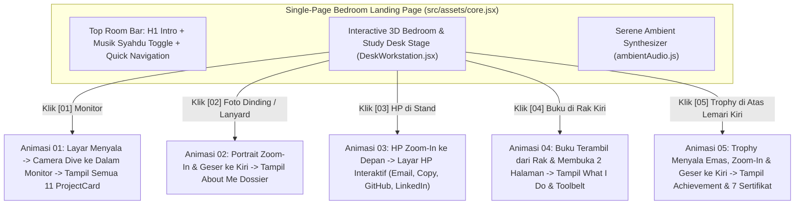

# Implementation Plan: Single-Page Interactive 3D Bedroom & Real Study Desk ("Bagas's Room" Edition)

## 1. Ringkasan Perubahan Arsitektur

Perombakan ini mengubah portofolio menjadi **Satu Landing Page Kamar & Meja Belajar Interaktif (Single-Page Room Experience)** yang memodelkan secara presisi foto meja asli Bagas ([`src/assets/WhatsApp Image 2026-11-07 at 20.53.34.jpeg`](file:///d:/Bagas/Portofolio/Portofolio/src/assets/WhatsApp%20Image%202026-11-07%20at%2020.53.34.jpeg)), lengkap dengan:
1. **Background Jendela Pemandangan & Wallpaper Kamar Sejuk (`Cool Slate/Twilight Room + Scenic Window`)**.
2. **Furniture Kayu Jati Asli (`Teak Cabinet + Study Desk with Hutch + Right Drawers`)** beserta pernak-pernik: Monitor Eksternal, Gaming Laptop berlampu keyboard merah, Keyboard & Mouse, Kipas Mini, Hanger + Lanyard ID, Buku di Rak Kiri, HP di Stand Meja, Bingkai Foto Dinding, dan Trophy di Atas Lemari Kiri.
3. **Musik Latar Syahdu (`src/assets/desk/ambientAudio.js`)** berbasis Web Audio API.
4. **5 Animasi Transisi Kamera & Objek Sinematik** yang menggantikan *pop-up* biasa dari bawah.

---

## 2. Pemodelan 3D Meja Belajar & Lemari Asli (`src/assets/desk/deskGeometry.js`)

Geometri 3D isometrik akan dirombak agar merepresentasikan wujud fisik foto [`src/assets/WhatsApp Image 2026-11-07 at 20.53.34.jpeg`](file:///d:/Bagas/Portofolio/Portofolio/src/assets/WhatsApp%20Image%202026-11-07%20at%2020.53.34.jpeg) dengan palet kayu jati hangat (`--wood-top`, `--wood-shade-0..3`) di dalam kamar ber-wallpaper sejuk (`--room-wall`, `--window-sky`):

1. **Latar Kamar, Wallpaper Sejuk & Jendela Pemandangan (`buildRoomAndWindow`)**:
   - Dinding kamar bersudut dengan *tone* biru-abu sejuk (*cool slate/teal wallpaper*), *baseboard*, dan lantai keramik putih berpola grid halus.
   - **Jendela Kamar di Dinding Belakang**: Menampilkan langit malam/senja yang teduh, siluet pegunungan/pepohonan, bintang & bulan sabit lembut, serta bias cahaya sejuk yang jatuh ke meja.
   - **Pintu Kayu di Sisi Kanan Kamar**: Meniru pintu kayu beserta gagang emas di sisi kanan foto asli.
2. **Lemari & Rak Buku Kayu Tinggi di Sebelah Kiri (`buildLeftCabinet`)**:
   - Bodi lemari kayu jati tinggi di sisi kiri meja (`x: -210..-95`).
   - **3 Rak Terbuka Kiri (`Open Cubbies`)**: Berisi deretan **Buku & Catatan Lab (`[04] What I Do`)** yang bisa diklik, ditambah detail kotak hijau/hitam & kotak ungu seperti di foto.
   - **Pintu Lemari Kanan**: Lengkap dengan gagang vertikal perak dan **Hanger Biru + Lanyard ID Card** yang tergantung.
   - **Puncak Lemari Kiri Atas (`[05] Trophy & Certs Hotspot`)**: Tempat berdirinya **Trophy Kejuaraan** yang berkilau dan 7 map sertifikat.
3. **Meja Belajar Kayu, Papan Hutch Atas & Laci Kanan (`buildStudyDesk`)**:
   - Permukaan meja belajar kayu jati (`x: -95..175`), kolong kaki meja di kiri, dan **2 Laci Kayu berlapis kenop perak** di kanan bawah.
   - **Papan Sandaran Atas (*Hutch Backboard*) & Dinding Samping Kanan Berlubang**: Lengkap dengan stiker kecil di tengah papan atas dan *power strip* putih + kabel di tiang kiri.
4. **Setup Komputer, Gaming Laptop, Kipas Mini & HP di Stand (`buildDeskSetup`)**:
   - **`[01]` Monitor Widescreen Hitam di Tengah-Kiri Meja**: Layar datar di atas *stand* persegi, dengan **Keyboard Mekanis** dan **Mouse + Mousepad Hitam** di depannya.
   - **Gaming Laptop di Sisi Kanan Meja**: Bodi hitam dengan **nyala lampu merah pada keyboard (*red backlit keyboard*)** dan tampilan *code editor* di layarnya (bagian dari grup hotspot komputer/proyek).
   - **Kipas Mini Putih & Coaster Biru** di sudut kiri meja.
   - **`[03]` HP di Atas Stand (`Smartphone on Stand`)**: Terletak di sisi kiri meja belajar, layar menghadap pengguna dengan notifikasi kontak.
   - **`[02]` Bingkai Foto Dinding (`Wall Portrait`)**: Terpasang di dinding kamar menampilkan [`src/assets/profile.jpg`](file:///d:/Bagas/Portofolio/Portofolio/src/assets/profile.jpg).

---

## 3. Koreografi 5 Animasi Klik Sinematik (`DeskWorkstation.jsx` & `desk.css`)

Setiap hotspot memiliki titik fokus kamera 2D (`cameraTarget: { originX, originY, scale }`) pada SVG serta **Interactive Stage Scene** khusus:

1. **Animasi `[01]` Monitor — *"Screen Power-On & Dive Into Monitor"* (`Projects`)**:
   - Saat Monitor diklik, layar monitor pada SVG menyala terang (`data-booting="true"`), dan kanvas kamar melakukan transformasi CSS `transform: scale(3.2) translate(...)` tepat ke tengah layar monitor.
   - Transisi berlanjut mulus ke tampilan **Full-Monitor OS (`BagasOS // All 11 Projects`)** yang dibingkai oleh *bezel* monitor lengkap dengan lampu LED power, filter kategori proyek, dan **11 `ProjectCard`** yang sudah ada.
2. **Animasi `[05]` Trophy — *"Trophy Glow, Zoom & Slide-Aside"* (`Achievements & Certifications`)**:
   - Saat Trophy di kiri atas meja diklik, kamera *zoom-in* ke area puncak lemari kiri.
   - Di panggung utama, **3D/SVG Trophy berukuran besar tampil menyala keemasan (*pulsing golden halo + sparkles*) lalu bergeser mulus ke sisi kiri (`translateX`)**, sementara sisi kanan memunculkan kartu **Achievements & 7 Sertifikat Terverifikasi** (lengkap dengan tombol buka PDF/Credly).
3. **Animasi `[04]` Buku di Rak Kiri — *"Book Pull-Out & 2-Page Unfold"* (`What I Do / Skills`)**:
   - Saat Buku di rak lemari kiri diklik, animasi menampilkan buku yang **ditarik keluar dari rak, melayang ke tengah, lalu membuka sampulnya (`book-unfold` animation) menjadi dua halaman terbuka**:
     - **Halaman Kiri:** 5 Disiplin Utama *What I Do* (*Data Science & ML*, *Data Engineering*, *EDA*, *Evaluation*, *Deployment*).
     - **Halaman Kanan:** 16 *Core Toolbelt* & arsitektur *pipeline*.
4. **Animasi `[03]` HP di Stand — *"Smartphone Zoom-In & Interactive Contact App"* (`Contact Me`)**:
   - Saat HP di *stand* meja diklik, HP melakukan **zoom-in ke depan layar menjadi wujud Smartphone Vertikal Berukuran Penuh** (lengkap dengan *speaker notch*, jam, indikator sinyal, dan layar menyala).
   - Di dalam layar HP tersebut terdapat tombol aplikasi interaktif: **Kirim Email (`mailto:bagasadjie2006@gmail.com`)**, **Copy Email** (dengan notifikasi `"Copied!"`), **LinkedIn**, dan **GitHub**.
5. **Animasi `[02]` Foto Dinding / Lanyard — *"Portrait Zoom & Slide-Aside"* (`About Me`)**:
   - Saat Foto Dinding diklik, bingkai foto Bagas (`profile.jpg`) **zoom-in lalu bergeser ke kiri dengan sorotan cahaya hangat**, sementara sisi kanan menampilkan narasi **About Me** & fakta kunci Bagas.

---

## 4. Synthesizer Musik Syahdu (`src/assets/desk/ambientAudio.js`)

- Menggunakan **Web Audio API (`AudioContext`)** murni tanpa dependensi eksternal:
  - **Pad & Rhodes Chord Progression**: Memainkan progresi akor syahdu (*warm lofi/ambient seventh chords*: `Fmaj7` – `Em7` – `Dm9` – `Cmaj7`) menggunakan osilator `sine` + `triangle` ber-filter *low-pass* hangat (`BiquadFilterNode`) dan *envelope* lembut.
  - **Kontrol UI**: Tombol **`🎵 Musik Syahdu: ON / OFF`** di bar atas kamar dengan animasi bar equalizer saat aktif, serta *auto-start* opsional pada klik pertama di kamar.
  - **Fallback Aman**: Jika dijalankan di lingkungan test (Vitest/jsdom yang tidak memiliki `AudioContext`), modul otomatis memakai *no-op stub* sehingga tidak pernah melempar error pada test.

---

## 5. Rencana File yang Disentuh

| File | Perubahan |
|---|---|
| `src/assets/desk/deskModel.js` | Update koordinat 5 hotspot sesuai posisi meja asli (`monitor`, `photo`, `phone` [HP di stand], `notebook` [Buku di rak kiri], `trophy` [Piala di kiri atas lemari]) + target kamera zoom. |
| `src/assets/desk/deskGeometry.js` | Rombak geometri 3D menjadi Kamar Sejuk + Jendela Pemandangan + Lemari Kayu Kiri (Rak Buku, Hanger Lanyard, Trophy di Atas) + Meja Belajar Kayu (Monitor, Gaming Laptop merah, Keyboard, Mouse, HP di Stand, Laci Kanan). |
| `src/assets/desk/ambientAudio.js` | **(Baru)** Modul Web Audio API untuk *Musik Syahdu* (*play*, *pause*, *toggle*, *volume*). |
| `src/assets/desk/desk.css` | Update palet warna *Cool Room Wallpaper + Warm Teak Wood* serta keyframes animasi *Monitor Dive*, *Glowing Trophy Slide*, *Book Pull-Out & Unfold*, dan *Smartphone Zoom*. |
| `src/assets/desk/DeskWorkstation.jsx` | Implementasi 5 transisi panggung sinematik (termasuk integrasi seluruh `projectsData` & `ProjectCard` di dalam layar Monitor), kontrol *Musik Syahdu*, dan tombol `← Kembali ke Kamar [ESC]`. |
| `src/assets/core.jsx` | Menjadikan halaman utama sebagai **Single-Page Bedroom Experience** yang bersih tanpa *scroll* panjang, sambil menjaga kompatibilitas penuh dengan seluruh 36 file test yang ada. |
| `src/assets/DeskWorkstation.unit.test.jsx` | Update & perluas unit test untuk menguji 5 animasi stage baru (Monitor Project Explorer, Glowing Trophy, Unfolded Book, Smartphone Contact App, About Portrait) dan kontrol Musik Syahdu. |
