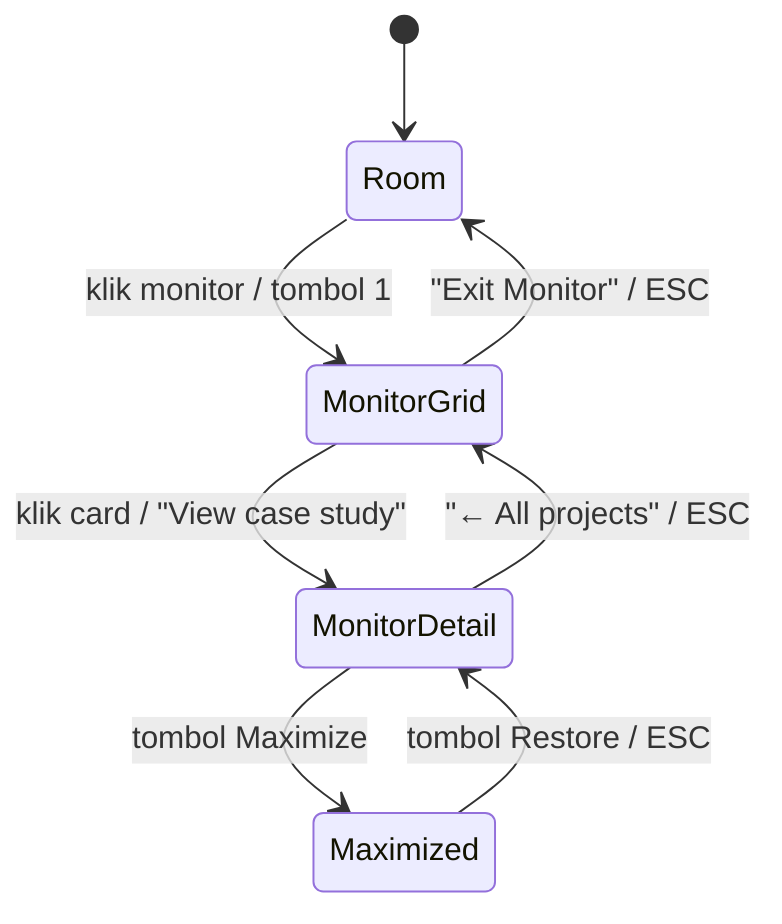

# Plan: Project Case Study (Detail) di dalam Monitor + Live Demo Strategy

> Status: **Draft — menunggu approval Bagas sebelum coding.**
> Task list eksekusi ada di [`project-detail-todo.md`](./project-detail-todo.md).
> Plan lama (Bagas's Room) tetap di [`plan.md`](./plan.md) / [`todo.md`](./todo.md) — tidak diubah.

---

## 1. Tujuan

Saat ini `ProjectCard` hanya menampilkan judul, metric, deskripsi panjang, tech, dan link GitHub. Recruiter tidak bisa melihat **masalah → solusi → arsitektur → bukti → demo**.

Target:

1. Klik project card di layar monitor → layar monitor berganti menjadi **halaman case study project** (tetap di dalam bezel monitor, vibe "lagi pakai komputer Bagas").
2. Ada tombol **Maximize** supaya case study memenuhi seluruh layar browser, dan tombol **Restore** untuk kembali ke ukuran monitor.
3. Setiap case study punya anatomi tetap (6 section) + slot **Live Demo** yang mendukung beberapa jenis demo.
4. Setiap project punya URL sendiri (`/project/<slug>`) supaya bisa ditaruh di CV/LinkedIn.
5. **Fase UI/UX dulu.** Deploy demo model dibuat belakangan sebagai panduan step-by-step (Phase 8).

## 2. Kondisi Codebase Sekarang (hasil explore)

| Hal | Lokasi | Catatan |
|---|---|---|
| Data project (11 item) | `src/assets/project.jsx` → `projectsData` | Field: `id, title, category, metric, description, image, tech, repoUrl`. Belum ada `slug`. |
| Card | `ProjectCard` di `project.jsx` | Sudah punya tilt + reveal, link demo/repo opsional. Tidak bisa diklik untuk detail. |
| Monitor | `DeskWorkstation.jsx` → `openStageId === "monitor"` | Bezel top bar, filter kategori, grid card, bezel chin. ESC = keluar monitor. |
| Halaman `/project` | `Projects` di `project.jsx` | Grid biasa + filter. |
| Routing | `src/App.jsx` | Hanya `/` dan `/project`. |
| Test invariants | `.agent/notes.md` §3 | Satu `<h1>` per route, heading tidak boleh lompat, semua `<a>`/`<button>` wajib accessible name. |

Stack: React 19, React Router 7, Vite 6, Tailwind 4, Vitest 4. **Tidak ada library UI/diagram tambahan** — plan ini sengaja tidak menambah dependency.

## 3. Keputusan Desain

### 3.1 Alur UX (3 level)



**Tumpukan ESC (stack):** ESC selalu menutup *satu level saja*: Maximized → Detail → Grid → Room. Ini mencegah pengunjung terlempar ke kamar saat cuma mau keluar dari fullscreen.

### 3.2 Maximize: CSS overlay, bukan Fullscreen API

| Opsi | Pro | Kontra |
|---|---|---|
| **CSS overlay (`fixed inset-0`)** ✅ dipilih | ESC bisa dikontrol sendiri, iframe demo tetap normal, jalan di semua browser termasuk iOS Safari | Browser chrome (address bar) tetap terlihat |
| Fullscreen API (`requestFullscreen`) | Benar-benar layar penuh | Browser "memakan" ESC pertama, iOS Safari tidak support untuk elemen non-video, bisa konflik dengan iframe |

Opsional nanti: tombol kedua "True fullscreen" berbasis Fullscreen API untuk desktop saja.

**Mobile (< 768px):** monitor sudah sempit, jadi detail **otomatis dibuka dalam mode maximized** dan tombol Restore disembunyikan.

### 3.3 Card jadi clickable tanpa merusak link GitHub

Card sudah berisi `<a>` (GitHub/Demo). Menaruh `<a>` di dalam `<button>` itu HTML invalid. Solusi:

- Tambah tombol eksplisit **"View case study →"** di card (accessible name jelas).
- Seluruh area card juga bisa diklik via teknik *stretched link* (pseudo-element `::after` di tombol menutupi card), sementara link GitHub diberi `relative z-10` supaya tetap bisa diklik sendiri.
- `ProjectCard` menerima prop baru opsional `onOpenDetail`. Kalau tidak dikirim, card berperilaku seperti sekarang → test lama aman.

### 3.4 Data: pisahkan konten detail dari data card

File baru `src/assets/projectDetails.js` berisi konten case study per `slug`. `projectsData` hanya ditambah field `slug`. Alasan: `project.jsx` sudah 441 baris; konten detail 11 project akan sangat panjang.

Schema (JSDoc, divalidasi oleh unit test):

```js
/**
 * @typedef {Object} ProjectDetail
 * @property {string} slug
 * @property {string} tagline            1 kalimat TL;DR
 * @property {{ role?: string, timeline?: string, team?: string, context?: string }} meta
 * @property {{ statement: string, whoIsAffected: string, whyML: string, constraints: string[] }} problem
 * @property {{ sources: {name: string, detail: string}[], challenges: {issue: string, fix: string}[] }} data
 * @property {{ nodes: {id: string, label: string, kind: "input"|"process"|"model"|"guard"|"output"}[],
 *              edges: {from: string, to: string, label?: string}[] }} architecture
 * @property {{ decision: string, chosen: string, alternative: string, why: string }[]} tradeoffs
 * @property {{ name: string, value: string, baseline?: string, note?: string }[]} metrics
 * @property {string[]} impact            dampak / apa artinya metrik untuk user
 * @property {string[]} limitations       jujur: apa yang belum & next steps
 * @property {DemoConfig} demo
 * @property {{ label: string, url: string }[]} artifacts   repo, notebook, HF model card, dsb.
 */

/**
 * @typedef {Object} DemoConfig
 * @property {"iframe"|"playground"|"in-browser"|"none"} type
 * @property {"live"|"coming-soon"} status
 * @property {string} [url]          untuk iframe (Streamlit / HF Space)
 * @property {string} [component]    nama komponen playground (lazy-loaded)
 * @property {string} [coldStartNote] mis. "Bisa butuh ~30 detik untuk bangun dari sleep"
 */
```

### 3.5 Anatomi halaman detail

| # | Section | Isi | Komponen |
|---|---|---|---|
| 0 | **Header** | Kategori, judul, tagline, metric chips, tech pills, tombol GitHub / Demo | `DetailHeader` |
| 1 | **Problem & Context** | Masalah, siapa terdampak, kenapa perlu ML, constraints | `ProblemSection` |
| 2 | **Data & Pipeline** | Sumber data, tabel *challenge → fix* (imbalance, leakage, dsb.) | `DataSection` |
| 3 | **Architecture & Trade-offs** | Diagram alur + kartu keputusan (dipilih vs alternatif + alasan) | `ArchitectureDiagram`, `TradeoffList` |
| 4 | **Validation & Impact** | Tabel metrik **dengan baseline**, dampak, limitations | `MetricsTable` |
| 5 | **Live Demo** | Slot demo sesuai `demo.type` | `DemoPanel` |
| 6 | **Code & Artifacts** | Repo, notebook, model card | `ArtifactLinks` |

Navigasi dalam detail: **mini TOC** (chip 1–6) yang sticky di atas konten monitor, dengan highlight section aktif (scroll-spy pakai `IntersectionObserver`, fallback aman di jsdom).

### 3.6 Diagram arsitektur tanpa library

Render diagram dari `architecture.nodes/edges` sebagai **pipeline HTML/CSS** (kolom/baris kotak + panah), bukan Mermaid (Mermaid menambah ±500 KB). Warna node mengikuti `kind` dan palet "Lab Notebook" (`ink`, `signal`, `marker`, `paper-2`). Layout: horizontal di desktop/maximized, vertikal di mobile. Untuk graph bercabang (mis. RAG: router → RAG vs escalate), dukung *branch* sederhana; kalau terlalu rumit, fallback ke gambar SVG statis per project di `public/architecture/<slug>.svg`.

### 3.7 DemoPanel — 4 mode (UI dibuat sekarang, isi demo belakangan)

| `type` | Perilaku UI |
|---|---|
| `iframe` | **Tidak** auto-load. Tampil kartu "▶ Launch live demo" + catatan cold start. Klik → iframe di-mount (lazy) dengan skeleton loading + tombol "Open in new tab". Hemat bandwidth & tidak membangunkan server tiap ada pengunjung. |
| `playground` | Komponen interaktif dari JSON pre-computed, di-load via `React.lazy` supaya bundle utama tidak membengkak. |
| `in-browser` | Model ONNX / TF.js di-load di browser saat tombol diklik (progress bar ukuran download). |
| `none` / `coming-soon` | Kartu jujur: "Demo sedang disiapkan" + link repo + screenshot/GIF hasil (kalau ada). |

Di fase UI/UX, semua project memakai `coming-soon` kecuali yang sudah punya URL demo.

### 3.8 Deep link `/project/:slug`

- Route baru `/project/:slug` memakai komponen `ProjectDetail` yang **sama** dengan di monitor, dibungkus layout halaman biasa (punya tepat satu `<h1>` = judul project).
- Di dalam monitor, judul project memakai `<h2>` (monitor sudah berada di bawah `<h1>` halaman `/`). → `ProjectDetail` menerima prop `headingLevel` (2 di monitor, 1 di route) dan menurunkan level section secara konsisten agar tidak lompat.
- Slug tidak ditemukan → tampilan "Project not found" + link balik ke `/project`.
- Monitor: tombol "Copy link" di header detail menyalin URL `/project/<slug>`.

## 4. File yang Akan Disentuh

| File | Aksi |
|---|---|
| `src/assets/project.jsx` | Tambah `slug` di `projectsData`; `ProjectCard` terima `onOpenDetail`; `Projects` page pakai navigasi ke `/project/:slug` |
| `src/assets/projectDetails.js` | **Baru** — konten case study + schema JSDoc |
| `src/assets/detail/ProjectDetail.jsx` | **Baru** — komponen utama + sub-section |
| `src/assets/detail/ArchitectureDiagram.jsx` | **Baru** |
| `src/assets/detail/DemoPanel.jsx` | **Baru** |
| `src/assets/detail/detail.css` | **Baru** (kalau Tailwind tidak cukup, mis. panah diagram) |
| `src/assets/desk/DeskWorkstation.jsx` | State `selectedSlug`, `isMaximized`, ESC stack, render detail di dalam monitor |
| `src/assets/desk/desk.css` | Animasi transisi grid ↔ detail, mode maximized |
| `src/App.jsx` | Route `/project/:slug` |
| Test baru | `projectDetails.schema.test.js`, `ProjectDetail.unit.test.jsx`, `DeskWorkstation.detail.unit.test.jsx`, `DemoPanel.unit.test.jsx` |

## 5. Risiko & Mitigasi

| Risiko | Mitigasi |
|---|---|
| Test property `ProjectCard.*` (12 file) gagal karena struktur card berubah | Perubahan card bersifat aditif & opsional (`onOpenDetail`); jalankan seluruh test `ProjectCard.*` setelah Task 2.1 |
| Invariant heading (1 `<h1>`, tidak lompat) rusak | Prop `headingLevel`; tambahkan route `/project/:slug` ke test heading |
| `DeskWorkstation.jsx` sudah 1.400+ baris | Logika detail ditaruh di komponen baru; Desk hanya pegang state & ESC |
| ESC bentrok dengan handler yang sudah ada | Satu handler ESC dengan urutan prioritas yang jelas + unit test per level |
| Konten case study dikarang (halusinasi) | Konten **wajib** bersumber dari README/notebook repo `TheGasz`; field yang tidak ada sumbernya ditandai `TODO(Bagas)` untuk diisi/diverifikasi Bagas |
| Bundle membengkak karena demo | Playground & in-browser model di-lazy-load; iframe hanya di-mount saat diklik |
| Focus hilang saat ganti view (a11y) | Pindah fokus ke judul detail saat dibuka, kembalikan fokus ke card asal saat kembali |

## 6. Koreksi & Catatan Jujur dari Diskusi Sebelumnya

- Pemetaan 11 project → 3 strategi demo yang saya berikan **baru berdasarkan deskripsi di `projectsData`**, belum membaca isi repo GitHub satu per satu. Akan diverifikasi di Phase 0.
- Batas resource **Streamlit Community Cloud** (RAM) dan status **free tier HF Spaces** (Gradio CPU basic vs Docker) belum saya verifikasi dari halaman resmi; hasil search sempat kontradiktif. Akan dicek ulang dari dokumentasi resmi di Phase 8 sebelum menulis panduan deploy.
- RAG IndoBERT + FAISS + cross-encoder kemungkinan **melebihi** RAM gratisan Streamlit Cloud. Alternatif yang akan dibandingkan di Phase 8: versi demo yang lebih ringan (model kuantisasi / index kecil) atau playground pre-computed.

## 7. Asumsi (koreksi kalau salah)

1. Konten case study ditulis dalam **bahasa Inggris**, konsisten dengan copy portofolio sekarang.
2. Deskripsi panjang di card akan **dipendekkan** (2–3 kalimat) setelah detail ada, karena cerita lengkap pindah ke halaman detail.
3. Tidak menambah dependency npm baru di fase UI/UX.
4. Mulai dari **1 project pilot** (Enterprise AI Support Copilot / RAG) sampai UI matang, baru konten 10 project lain diisi.

## 8. Definition of Done (fase UI/UX)

- [ ] Klik card di monitor → detail tampil di dalam monitor; "← All projects" & ESC kembali ke grid.
- [ ] Maximize/Restore jalan; ESC menutup satu level; mobile otomatis maximized.
- [ ] `/project/<slug>` bisa dibuka langsung & di-share; slug salah → not found.
- [ ] 11 project punya konten detail (yang belum terverifikasi ditandai jelas).
- [ ] DemoPanel menampilkan state yang benar untuk tiap `type`/`status`.
- [ ] `npm test`, `npm run lint`, `npm run build` lulus; cek visual desktop + mobile + `prefers-reduced-motion`.

