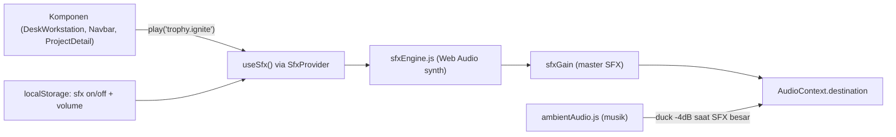
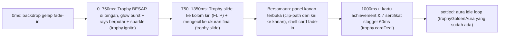
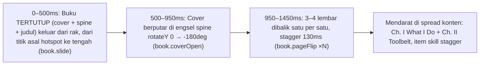

# Plan: UX Enhancement — Interaction Sound (SFX) + Hotspot Choreography

> Status: **Draft — nunggu approval Bagas sebelum coding.**
> Task list eksekusi ada di [`ux-sound-motion-todo.md`](./ux-sound-motion-todo.md).
> Plan lama (`plan.md`, `project-detail-plan.md`) tidak diubah.

---

## 1. Tujuan

1. **Setiap interaksi di web punya feedback suara** yang sesuai konteks (hover, klik hotspot, buka/tutup, copy, tab, toggle, error), terasa satu "palet" dengan musik lofi yang sudah ada.
2. **Animasi buka hotspot jadi bercerita (choreographed)**, bukan sekadar pop-in:
   - **Trophy (05):** trophy bersinar muncul **besar di tengah layar** → **slide ke kiri** ke posisi kolomnya sekarang → **sambil slide**, panel *Achievements & Certifications* terbuka dari kanan.
   - **Buku (04):** buku **tertutup** keluar dari rak → **cover terbuka** → **lembar halaman dibalik satu per satu** → mendarat di spread konten.
   - Hotspot lain (monitor, name tag, phone, documents, pintu) dapat choreography sendiri (detail §4.3).
3. Tetap aman: aksesibel, ada mute, hormati `prefers-reduced-motion`, tidak merusak test invariant.

## 2. Kondisi Codebase Sekarang (hasil explore)

| Hal | Lokasi | Catatan |
|---|---|---|
| Hotspot data (6) | `src/assets/desk/deskModel.js` → `DESK_HOTSPOTS` | Sudah ada `cameraZoom {scale, originX, originY}` per hotspot — bisa dipakai sebagai titik asal animasi. |
| State & stage render | `src/assets/desk/DeskWorkstation.jsx` (1487 baris) | `openStageId` toggle → `renderCinematicStage()` render dialog per hotspot. Keyboard 1–6, ESC, door Enter. |
| Animasi stage | `src/assets/desk/desk.css` L551–717 | 1 keyframe pop-in per stage (`stageTrophySlideAside`, `stageBookPullAndOpen`, dst.) ±400–640ms. Belum ada sequence multi-tahap, belum ada exit animation. |
| Audio | `src/assets/desk/ambientAudio.js` | Web Audio synth zero-asset (lofi chord F major). Fallback no-op di jsdom. **Belum ada SFX.** |
| Reduced motion | `desk.css` L818–843 | Semua `.stage-*` → `animation: none`. |
| Test terkait | `src/assets/DeskWorkstation.unit.test.jsx`, `desk/DeskWorkstation.detail.unit.test.jsx` | **Dialog `desk-overlay-*` harus ada di DOM langsung setelah klik, dan hilang langsung setelah close** (`getByTestId` / `queryByTestId` sinkron). |

Stack: React 19, Vite 6, Tailwind 4, Vitest 4. **Plan ini tidak menambah dependency** (tanpa GSAP/Framer/Howler) — konsisten dengan keputusan sebelumnya.

## 3. Sound Design (SFX)

### 3.1 Arsitektur

- **`src/assets/audio/sfxEngine.js`** — `createSfxEngine()` → `{ unlock(), play(name, opts), setEnabled(), setVolume(), cleanup() }`. Semua bunyi disintesis (oscillator + filtered noise buffer + envelope), sama seperti `ambientAudio.js`. No-op aman kalau `AudioContext` tidak ada (jsdom).
- **`src/assets/audio/sfxCatalog.js`** — data murni: nama cue → resep (tipe, frekuensi, durasi, gain). Gampang di-test & di-tuning tanpa sentuh engine.
- **`src/assets/audio/SfxProvider.jsx` + `useSfx()`** — context supaya Navbar/ProjectDetail juga bisa bunyi. Simpan preferensi di `localStorage` (`bagas.sfx.enabled`, `bagas.sfx.volume`).
- **Abstraksi siap-sample:** resep boleh bertipe `sample` (file di `public/sfx/`) kalau nanti synth untuk page-flip/door kurang natural → bisa ganti ke pack CC0 (mis. Kenney) tanpa ubah komponen.

### 3.2 Aturan UX Suara

- **Unlock di gesture pertama** (klik pintu "My Portofolio") — sesuai autoplay policy browser; sebelum itu `play()` diam.
- **Default ON setelah masuk room**, ada tombol **SFX on/off** terpisah dari tombol Musik Syahdu (pojok kontrol yang sama). Shortcut `M` = mute semua (opsional).
- **Volume rendah & konsisten**: master SFX ±0.18, hover jauh lebih pelan dari klik. Tidak ada bunyi > 600ms kecuali signature hotspot.
- **Throttle hover** 90ms + **max polyphony** 8 voice → tidak "berisik" saat mouse disapu.
- **Pitch map pentatonik F mayor** per hotspot (01→F5, 02→G5, 03→A5, 04→C6, 05→D6, 06→F6) → hover terasa musikal & nyambung dengan musik ambient.
- **Device touch (`pointer: coarse`)**: tanpa hover sound; klik tetap bunyi; `navigator.vibrate(10)` opsional untuk copy/success.
- **Suara bukan satu-satunya feedback** (a11y): semua state tetap visual + `aria-live` readout yang sudah ada.
- **Duck musik** −4dB selama 600ms saat cue signature (trophy/book/monitor) supaya tidak tabrakan.

### 3.3 Katalog Cue (usulan)

| Area | Interaksi | Cue | Karakter bunyi |
|---|---|---|---|
| Global | Hover/focus hotspot & dock | `ui.hover` (+pitch per hotspot) | Tick kayu pendek 20ms, bandpass noise + sine pentatonik sangat pelan |
| Global | Klik tombol umum | `ui.press` | "Thock" lembut 40ms |
| Global | Close / ESC / Back to Room | `ui.close` | Thock turun nada (descending) |
| Global | Toggle (pins, maximize, filter) | `ui.toggleOn` / `ui.toggleOff` | Switch click naik / turun |
| Global | Success (copy email, download) | `ui.success` | Ding 2 nada naik (C6→F6) |
| Global | Error (clipboard/iframe gagal) | `ui.error` | Buzz rendah 2× |
| Global | Link keluar (LinkedIn/GitHub/cert) | `ui.pop` | Pop bubble |
| Pintu | Hover pintu / klik masuk | `door.handle`, `door.open` | Klik gagang + creak sweep + room tone fade-in |
| Musik | On / Off | `music.needle`, `music.tapeStop` | Jarum vinyl turun / tape stop pitch-down |
| 01 Monitor | Buka / tutup | `monitor.powerOn`, `monitor.powerOff` | Klik relay + whine naik + static burst / collapse "bip" turun |
| 01 Monitor | Pilih project / back / dive | `monitor.select`, `monitor.back`, `monitor.dive` | Blip digital / blip terbalik / whoosh |
| 02 Name tag | Buka | `tag.swing`, `tag.flip` | Gemerincing lanyard (partial metalik) + swish kartu |
| 03 Phone | Buka | `phone.lift`, `phone.buzz`, `phone.unlock`, `phone.appPop` | Whoosh angkat, getar 2× 160Hz, chime unlock, pop per ikon |
| 04 Buku | Buka | `book.slide`, `book.coverOpen`, `book.pageFlip` (×N), `book.close` | Gesekan kayu, thud cover, swish kertas per lembar (variasi pitch acak ±8%), tutup "thump" |
| 05 Trophy | Buka | `trophy.ignite`, `trophy.slide`, `trophy.cardDeal` (stagger) | Shimmer/sparkle arpeggio, whoosh lembut, tick kartu tipis per sertifikat |
| 06 Documents | Buka / tab / download | `docs.folder`, `docs.paperSlide`, `docs.stamp` | Map dibuka + shuffle kertas, kertas geser, stempel "chak" |
| Router | Pindah halaman | `nav.whoosh` | Whoosh pendek |

## 4. Motion Choreography

### 4.1 Fondasi: `useStageChoreography`

Masalah sekarang: tiap stage cuma 1 keyframe. Butuh **timeline multi-fase** yang sinkron dengan suara.

- **`src/assets/desk/stageTimelines.js`** (data murni): per hotspot daftar fase `{ phase, at(ms), sfx? }`. Contoh trophy: `intro@0 (trophy.ignite) → slide@750 (trophy.slide) → open@750 → settled@1400`.
- **`src/assets/desk/useStageChoreography.js`**: input `openStageId` → output `phase`; set `data-stage-phase="<phase>"` pada dialog; CSS yang memegang animasinya (transform/opacity/clip-path only). Hook juga memicu cue SFX tepat di tiap fase.
- **Interruptible**: ESC / klik hotspot lain / klik backdrop saat intro → cancel timer, lompat ke fase akhir atau tutup. **Klik di mana saja saat intro = skip** (fast-forward ke `settled`).
- **Reduced motion**: lewati semua fase → langsung `settled` dengan fade 150ms; SFX tetap hanya cue utama.
- **Dialog tetap di-render sinkron** saat klik (fase hanya mengubah tampilan) → test `getByTestId("desk-overlay-*")` tetap lulus.
- **Focus management**: fokus pindah ke tombol close/heading saat fase `open` (atau langsung bila reduced motion).
- **Durasi total intro ≤ 1.5s**, exit ≤ 300ms. Animasi 3D tidak boleh di dalam elemen `overflow:auto` (preserve-3d jadi flat) → struktur: stage wrapper (3D, no overflow) → konten scrollable di dalam.

### 4.2 Choreography yang diminta

#### Trophy & Certifications (05)

- **Teknik FLIP**: `useLayoutEffect` ukur rect slot trophy final (`.stage-trophy-hero`) vs pusat overlay → set CSS var `--flip-x`, `--flip-y`, `--flip-scale`. Keyframe intro mulai dari `translate(var(--flip-x), var(--flip-y)) scale(var(--flip-scale))` lalu ke `none`. Otomatis benar di mobile (layout 1 kolom → trophy "slide ke atas" bukan ke kiri). Re-measure saat resize.
- **Card shell dipisah**: background/border dialog dipindah ke layer `::before` (`.stage-card-shell`) supaya shell bisa fade/clip tanpa ikut menyembunyikan trophy yang sedang terbang.
- Efek bersinar: radial rays (conic-gradient berputar), 8–12 partikel sparkle CSS (`aria-hidden`), flash putih tipis saat ignite.

#### Buku "What I Do" (04)

- Struktur 3D: `.book-stage` (perspective) → `.book` (preserve-3d) → `.book-cover` (front/back face), `.book-leaf` ×3 dekoratif (`aria-hidden`, `backface-visibility:hidden`) → `.book-spread` berisi konten asli (scroll di dalam page, bukan di wrapper 3D).
- Titik asal animasi pakai `cameraZoom.originX/Y` hotspot → buku benar-benar "keluar dari rak kiri".
- Mobile (< md): spread 1 halaman — cover buka lalu 2 lembar flip, konten single column.
- **Opsional (P2):** tombol `‹ ›` / arrow key untuk balik halaman antar bab (spread 1 = What I Do, spread 2 = Toolbelt) dengan animasi + `book.pageFlip`.
- Close: cover menutup cepat (300ms) + `book.close`.

### 4.3 Usulan choreography hotspot lain

| Hotspot | Choreography | Close |
|---|---|---|
| **01 Monitor** | Efek **CRT power-on**: layar hitam → garis horizontal tipis menyala (scaleY 0.01→1) → flash → scanline menyapu → boot text `bagas-os booting…` 400ms (typing) → grid project card stagger naik. Pilih card → card **expand jadi detail** (View Transitions API bila tersedia, fallback crossfade). | CRT power-off: konten collapse jadi garis lalu titik, `monitor.powerOff`. |
| **02 Name Tag** | ID card **jatuh dari atas dan berayun** di lanyard (damped pendulum −18°→12°→−6°→2°→0°) di tengah → **flip** memperlihatkan sisi belakang → slide ke kiri sementara panel bio terbuka ke kanan (pola konsisten dengan trophy). Hover kartu = tilt kecil. | Kartu terangkat ke atas + fade. |
| **03 Phone** | Phone **terangkat dari stand** (dari origin hotspot, rotateX → tegak) ke tengah → layar wake (gelap → terang) → **lock screen jam real-time** 500ms → swipe-up unlock → ikon app (Email, Copy, LinkedIn, GitHub) **pop spring** stagger. Copy email = ripple + checkmark + `ui.success` + vibrate. | Layar mati → phone turun ke stand. |
| **06 Documents** | Map/dossier **keluar dari laci** → flap map terbuka (rotateX) → 3 kertas (CV, Portfolio, Resume) **mengipas** (fan out) → kertas terpilih naik jadi viewer. Ganti tab = kertas geser kiri/kanan. Download = **stempel "DOWNLOADED"** bounce. | Kertas masuk lagi ke map, map menutup. |
| **Pintu masuk** | Hover: gagang turun sedikit + `door.handle`. Klik: gagang berputar → pintu swing (sudah ada) → **light spill** dari celah → room fade-in dengan camera dolly halus. | — |
| **Room hover** | Hotspot terangkat 2px + outline glow + pin pulse 1× + tick pitch-mapped. Hotspot lain sedikit dim (focus effect). | — |
| **Micro global** | Tombol press `scale(.97)`, ripple pada aksi sukses, toast kecil "Email copied", progress bar tipis saat iframe dokumen loading. | — |

## 5. Keputusan yang Perlu Approval

1. **Exit animation vs test.** Test sekarang mengharapkan dialog **langsung hilang** setelah close. Opsi:
   - **(Rekomendasi) B:** tambah fase `closing` 220–300ms, update test terkait pakai `waitForElementToBeRemoved` / fake timers; reduced motion = tetap instan.
   - A: close tetap instan, exit animation hanya pada objek di room (objek "kembali" ke tempat + suara). Lebih aman, kurang mulus.
2. **Sumber suara:** (Rekomendasi) **synth-first** zero-asset; page flip & door creak dievaluasi setelah Phase 2 — kalau terdengar "palsu", ganti ke sample CC0 (±50KB total, lazy-load).
3. **Default SFX:** (Rekomendasi) **ON** setelah klik pintu, dengan toggle mute yang disimpan di `localStorage`.

## 6. Risiko & Mitigasi

| Risiko | Mitigasi |
|---|---|
| `DeskWorkstation.jsx` makin gemuk (1487 baris) | Pecah stage trophy & book ke `desk/stages/TrophyStage.jsx`, `desk/stages/BookStage.jsx` (refactor terbatas, hanya yang disentuh). |
| Test break karena delay | Dialog render sinkron; fase hanya visual; test baru untuk hook pakai `vi.useFakeTimers()`. |
| Jank di laptop lemah / mobile | Hanya animasi transform/opacity/clip-path; `will-change` hanya selama fase aktif; profiling Chrome DevTools Performance (target ≥ 55fps, no long task > 50ms). |
| Suara mengganggu | Volume rendah, throttle, mute persist, tanpa hover sound di touch. |
| AudioContext bocor | Satu context per engine, `cleanup()` di unmount, node di-`stop()` + disconnect setelah envelope. |
| User spam klik saat intro | Choreography interruptible + skip-on-click; timer di-cancel di cleanup. |

## 7. Definition of Done

- Semua interaksi di §3.3 berbunyi sesuai katalog, bisa di-mute, tidak bunyi sebelum gesture pertama.
- Trophy & Buku sesuai alur §4.2; hotspot lain sesuai §4.3 (minimal Monitor, Phone, Name Tag, Documents).
- `prefers-reduced-motion` → tanpa choreography, tetap fungsional.
- `npm test`, `npm run lint`, `npm run build` hijau; invariant di `.agent/notes.md` §3 tidak dilanggar.
- QA manual di Chrome + Firefox + 1 device mobile; profiling performa tercatat.

